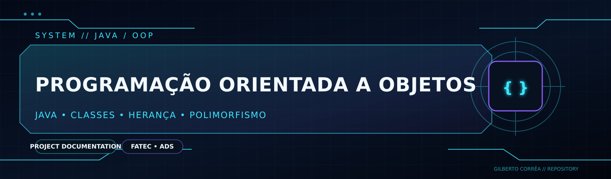
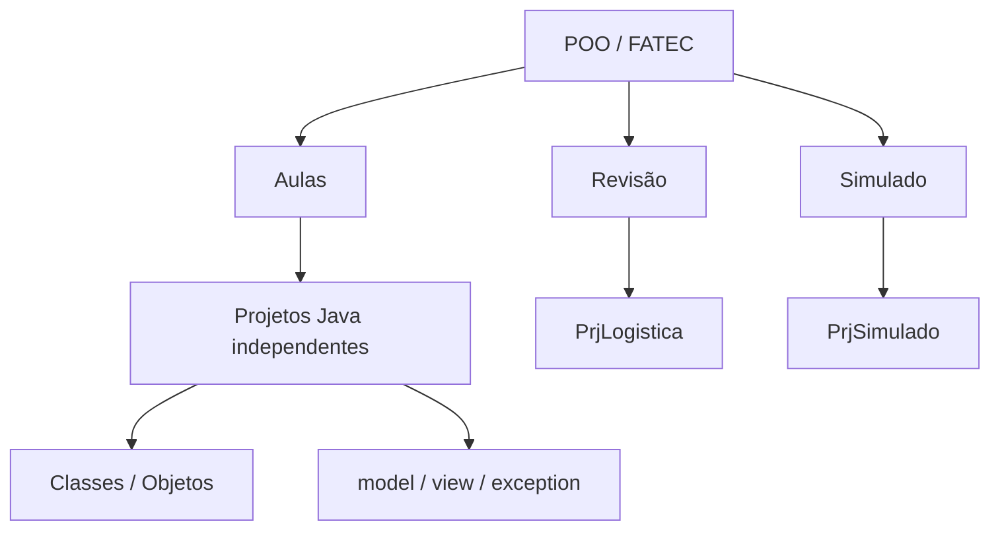

<div align="center">
  
</div>

<div align="center">

# P R O G R A M A Ç Ã O　O R I E N T A D A　A　O B J E T O S

### `JAVA • OBJECT-ORIENTED PROGRAMMING • ACADEMIC LAB`

**Explorando os fundamentos da orientação a objetos por meio de exercícios e projetos em Java.**


`FATEC` · `ADS` · `EXERCÍCIOS ACADÊMICOS`

[Visão geral](#visao-geral) · [Projetos](#projetos) · [Estrutura](#estrutura) · [Execução](#execucao) · [Conceitos](#conceitos)

</div>

---

<a id="visao-geral"></a>

## `POO // VISÃO GERAL`

Este repositório reúne atividades da disciplina de **Programação Orientada a Objetos** da **FATEC**, desenvolvidas em **Java**. Os exemplos estão distribuídos por aulas, revisões e simulados.

Os exercícios abordam **classes e objetos, encapsulamento, herança, polimorfismo, exceções, Collections e modelagem de sistemas**. Os projetos são independentes: não se trata de uma única aplicação web ou API.

## `SYSTEM // INVENTÁRIO`

| Componente | Presença no repositório |
| :--- | :---: |
| Exercícios de classes e objetos | `● PRESENTE` |
| Exemplos de vetores e Collections | `● PRESENTE` |
| Projetos com herança e subclasses | `● PRESENTE` |
| Exemplos de exceções personalizadas | `● PRESENTE` |
| Revisão e simulado | `● PRESENTE` |
| Aplicação única com deploy | `○ NÃO SE APLICA` |

<a id="projetos"></a>

## `JAVA CORE // PROJETOS E EXERCÍCIOS`

| Local | Conteúdo identificado |
| :--- | :--- |
| [`aula0303/`](aula0303/) | Projetos **Acampamento**, **Computador** e **Conta** |
| [`aula1003/`](aula1003/) | Exemplos de **vetor** e **estacionamento** |
| [`aula1404/`](aula1404/) | Projeto **Banco**, com classes `Conta`, `Corrente` e `Poupanca` |
| [`aula1603/`](aula1603/) | Projeto **Funcionarios** e atividade da aula |
| [`aula2403/`](aula2403/) | Modelos de **Aluno**, **Curso**, **Disciplina** e projeto **Tabuleiro** |
| [`aula2804/`](aula2804/) | **ControleDeCaixa**, com separação entre `model` e `view` |
| [`aula0505/`](aula0505/) | Tratamento de exceções, incluindo `CaixaException` |
| [`aula1205/`](aula1205/) | Exemplos de **Collection**, **Hash** e métodos |
| [`revisao/`](revisao/) | Exercícios de revisão, incluindo **PrjLogistica** |
| [`simulado/`](simulado/) | Simulado com `Produto`, `Livro`, `Dvd` e `EstoqueInsuficienteException` |

## `ARCHITECTURE // ORGANIZAÇÃO DOS EXERCÍCIOS`



<a id="estrutura"></a>

## `STRUCTURE // DIRETÓRIOS`

```text
POO/
├── aula2402/
├── aula0303/
├── aula1003/
├── aula1603/
├── aula2403/
├── aula1404/
├── aula2804/
├── aula0505/
├── aula1205/
├── revisao/
├── simulado/
└── README.md
```

As pastas contêm diferentes projetos Java, vários com estrutura própria de IDE (`.iml` e `.idea`) e código-fonte na pasta `src/`.

<a id="execucao"></a>

## `BOOT SEQUENCE // EXECUÇÃO LOCAL`

**Pré-requisitos:** JDK instalado e uma IDE Java, como IntelliJ IDEA, ou terminal com `javac` e `java`.

```bash
git clone https://github.com/gilbertocorrea-cmd/POO.git
cd POO
```

**Pelo IntelliJ:** abra a pasta de um dos projetos, configure o SDK Java e execute a classe que contém o método `main`.

**Pelo terminal:** para exercícios simples sem declaração de pacote e com os arquivos necessários na mesma pasta, por exemplo:

```bash
cd aula0303/ProjetoAcampamento/src
javac Acampamento.java AcampamentoTeste.java
java AcampamentoTeste
```

> **Nota:** os exemplos variam de estrutura; projetos que utilizam pacotes ou dependem de outras classes devem ser compilados com o caminho e os arquivos correspondentes. Não há comando Maven único na raiz.

<a id="conceitos"></a>

## `LEARNING // CONCEITOS PRATICADOS`

- **Classes e objetos:** criação de tipos e instâncias em Java.
- **Encapsulamento:** organização e proteção de atributos por meio da interface das classes.
- **Herança e polimorfismo:** relações entre superclasses e subclasses.
- **Exceções:** tratamento de erros e criação de exceções específicas.
- **Collections:** estruturas de dados e exemplos com hash.
- **Modelagem:** exercícios aplicados a conta bancária, escola, estacionamento, caixa, logística e estoque.

## `TECH // TECNOLOGIAS`

| Tecnologia | Uso |
| :--- | :--- |
| Java | Linguagem dos exercícios |
| IntelliJ IDEA | Projetos configurados para a IDE |
| UML | Conceito de modelagem trabalhado na disciplina |
| Java Collections Framework | Exercícios com coleções e hash |

---

<div align="center">

## `POO // CODE • LEARN • BUILD`

**Gilberto Corrêa**

Análise e Desenvolvimento de Sistemas — FATEC

[GitHub](https://github.com/gilbertocorrea-cmd) · [Repositório POO](https://github.com/gilbertocorrea-cmd/POO)

`JAVA` • `OOP` • `EXCEPTIONS` • `COLLECTIONS`

</div>
